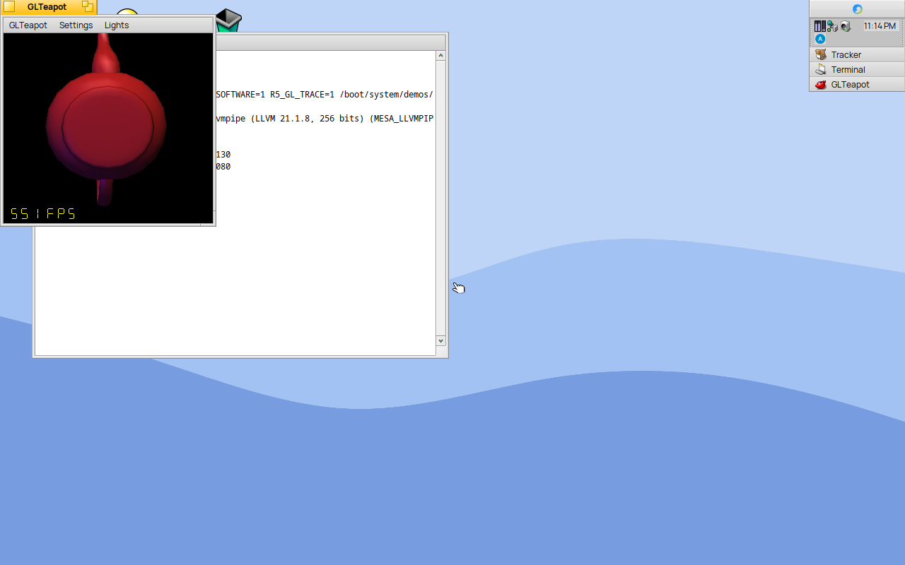

# OpenGL on the GPU (M9)

How an OpenGL program on R5 Operating System reaches the GPU, and how it falls back to software. The plan is `docs/GPU-ARCHITECTURE.md` (decision 11: OpenGL is Zink on RADV). This page describes what is built.

## The route

```
program (BGLView, EGL, GL)
  -> libglvnd 1.7.0 (libGL, libEGL)
  -> libEGL_mesa (package mesa 25.3.6-3), Haiku EGL driver
       -> llvmpipe (software, the default)
       -> Zink -> Vulkan loader -> RADV -> R5 DRM library -> /dev/gpu/radeon_hd/<n>
```

- llvmpipe stays installed and stays the default. radeonsi is not built.
- Zink is a Mesa driver that turns OpenGL into Vulkan. On the GPU it runs on RADV. Without a GPU it can run on Lavapipe, the Vulkan software driver; QEMU uses that to test the window path.

## What happened before M9 (recorded 12 Nov 2026)

QEMU, image from `origin/main` with `mesa-25.3.6-2`, after Sign in:

```
GALLIUM_DRIVER=zink LIBGL_ALWAYS_SOFTWARE=1 /boot/system/demos/GLTeapot
```

- The window opened with its menu bar and a **white drawing area**. No teapot.
- The program printed nothing and did not crash. It was still running after 60 s.
- Cause: `haiku_swap_buffers()` shows a frame with `flush_frontbuffer()`. On Zink, `zink_flush_frontbuffer()` returns at once when the buffer is not a kopper swapchain, and Haiku has none. Every frame was drawn and then dropped.

## Device order

Zink takes Vulkan physical device 0 unless `LIBGL_ALWAYS_SOFTWARE` is set, and refuses it when it is a CPU device.

| Machine | Before M9 | After M9 |
|---|---|---|
| 5625U (stick 41 self-test, `vulkaninfo --summary`) | GPU0 `llvmpipe` (CPU), GPU1 `AMD Radeon Graphics (RADV RENOIR)` | RADV first (expected, not yet booted) |
| QEMU | GPU0 `llvmpipe` only | unchanged |

Lavapipe was device 0 on the 5625U, so Zink would have refused it. The Khronos loader already sorts devices (discrete GPU, integrated GPU, virtual GPU, CPU), but only on Linux and the BSDs. R5's loader build (`distro/vulkan/patches/haiku-device-sort.patch`, `vulkan_loader-1.4.367-4`) turns that sort on for Haiku. Mesa has no device name or ID in it.

## Choosing the driver

Once per process, in `haiku_initialize_impl()`, in this order:

| # | Condition | Driver | Syslog line |
|---|---|---|---|
| 1 | `LIBGL_ALWAYS_SOFTWARE`, `GALLIUM_DRIVER` or EGL's force-software option is set | as before | none |
| 2 | `gpu_opengl false` | llvmpipe | none |
| 3 | `gpu false` | llvmpipe | `egl: opengl llvmpipe: gpu off` |
| 4 | `gpu_opengl_fail true` (test switch) | llvmpipe | `egl: opengl llvmpipe: forced failure` |
| 5 | no entry under `/dev/gpu/<driver>/` | llvmpipe | `egl: opengl llvmpipe: no render node` with `gpu_opengl true`; none when `gpu_opengl` is not set |
| 6 | the node's `GET_INFO` has no `R5_GPU_CAP_AVAILABLE` (M10) | llvmpipe | `egl: opengl llvmpipe: gpu not available` |
| 7 | Zink cannot start | llvmpipe | `egl: opengl llvmpipe: zink failed` |
| 8 | otherwise | Zink | `egl: opengl zink: <renderer>` |

- The settings are the radeon_hd driver settings, read with `load_driver_settings()`: `/boot/home/config/settings/kernel/drivers/radeon_hd`, then `/boot/system/settings/kernel/drivers/radeon_hd` (the order the R5 DRM library uses). The first file that exists is used. A file that exists but cannot be read, such as the administrator's file for a standard account, means "not set"; the system file is not read in its place. Not tested as a standard account.
- M10: with no `gpu_opengl` in the settings, the availability bit decides, so a standard account that cannot read the administrator's file gets Zink like the administrator. Only an explicit `gpu_opengl false`, `gpu false` or `gpu_opengl_fail` in the administrator's private file is not seen by a standard account. The R5 DRM library's `gpu_debug` has the same limit.
- A key without a value (`gpu_opengl` alone) means true, as for every R5 kernel switch.
- M10: Zink is the default when the bit is set. The kernel sets it after the four checks at boot (`docs/GPU-ARCHITECTURE.md`, "Which path is used"). `gpu_opengl true` forces case 5's line on a machine with no GPU; on a GPU without the bit it still gets llvmpipe. The patch is `distro/mesa/patches/haiku-zink-available.patch`, on top of `haiku-zink-present.patch`.
- With `R5_GL_TRACE=1` every line also goes to stderr. Cases 1 and 2 then print `egl: opengl <zink|llvmpipe>: <renderer>` to stderr only; the window test reads that line.
- When no driver can start at all, `eglInitialize` fails with `EGL_NOT_INITIALIZED`. Before, the EGL driver used a NULL screen and crashed.
- A running program never moves to llvmpipe. A failure after start is the program's failure.

## Showing a Zink frame

The EGL driver gives every surface of a Zink screen a present hook (`hgl_buffer.present`). Its colour buffers then have no `PIPE_BIND_DISPLAY_TARGET`.

- On `eglSwapBuffers` (and on a front-buffer flush) the hook maps the back buffer for reading and copies it into a `BBitmap`: `B_RGB32` for BGRX8888, `B_RGBA32` for BGRA8888. Any other format fails with one line.
- One `memcpy` when both rows are `width × 4` bytes, otherwise row by row. The bitmap is not cleared first.
- The bitmap goes to the window with `BitmapHook::SetBitmap()`. Up to two bitmaps that the window hands back are kept and reused at the same size; a kept bitmap of another size is deleted.
- When the surface is destroyed the shown bitmap is taken back and deleted with the kept ones.
- A failed map logs `egl: present failed` once per surface, and `eglSwapBuffers` returns `EGL_BAD_ALLOC`.
- With `R5_GL_TRACE=1`: `egl: present median <n> us frames <n>` every 10 s.
- A pbuffer crashed in `eglMakeCurrent` on every driver, llvmpipe too: `update_size()` asked the surface's window for its size, and a pbuffer has none. The same patch skips that for a pbuffer. Found in QEMU when `r5-gl-test --pbuffer` crashed.
- A pbuffer of a Zink screen gets the hook too, without a window: it shows nothing, and only keeps the display target off.

Not in M9: frames straight to the screen, swap interval, and `BGLView::SwapBuffers(vSync)`.

## Tests

- `r5-gl-test --pbuffer <file>`: one fixed frame (clear, two overlapping triangles with the depth test, a 4 × 4 checker texture with `GL_NEAREST`, a blended quad) in a 256 × 256 pbuffer, then 300 timed frames. Prints `gl driver`, `gl version`, six `pixel` lines and `gl ms per frame`.
- `r5-gl-test --selftest [--zink-cpu]`: run A (inherited environment, or Zink on Lavapipe with `--zink-cpu`) against run B (`LIBGL_ALWAYS_SOFTWARE=1`), compared with `r5_pixels_compare()`, max 2 per channel and 1%. Prints `pixels ok max 2 share <x>% limit 1%`, `pixels MISMATCH …` or `pixels ok llvmpipe only`. When the settings and a render node make the driver choose Zink but run A still got llvmpipe, it prints `pixels FAIL llvmpipe only, gpu_opengl true asks for zink` (exit 3), so a silent fallback cannot pass.
- Self-test stages `gl` and, without a render node, `gl zink-cpu`. Window tests `GLTeapot` and, without a render node, `GLTeapot-zink-cpu` (`win-glteapot.txt`, `win-glteapot-zink-cpu.txt`).

## Results

QEMU with KVM, 13 Nov 2026, branch `claude/m9-opengl-zink-fc7eb3`. The 5625U (RADV) has not run it yet.

| Check | Result |
|---|---|
| no setting | `egl lines in syslog 0` |
| `gpu_opengl true` | `egl: opengl llvmpipe: no render node` (once per program) |
| plus `gpu_opengl_fail true` | `egl: opengl llvmpipe: forced failure` |
| stage `gl` | `pixels ok llvmpipe only`, `gl ms per frame` 0.463 and 0.466 |
| stage `gl zink-cpu` | `pixels ok max 2 share 0.6% limit 1%`, Zink on Lavapipe 0.979 ms, llvmpipe 0.442 ms |
| window `GLTeapot-zink-cpu` | `window driver zink: zink Vulkan 1.4(llvmpipe …)`, every action `ok`, `device lost no` |
| present (Zink on Lavapipe) | median 1.2–1.6 ms per frame for GLTeapot's window |

The 0.6% in the Zink compare is edge pixels of the triangles; the largest channel difference there is 204.


